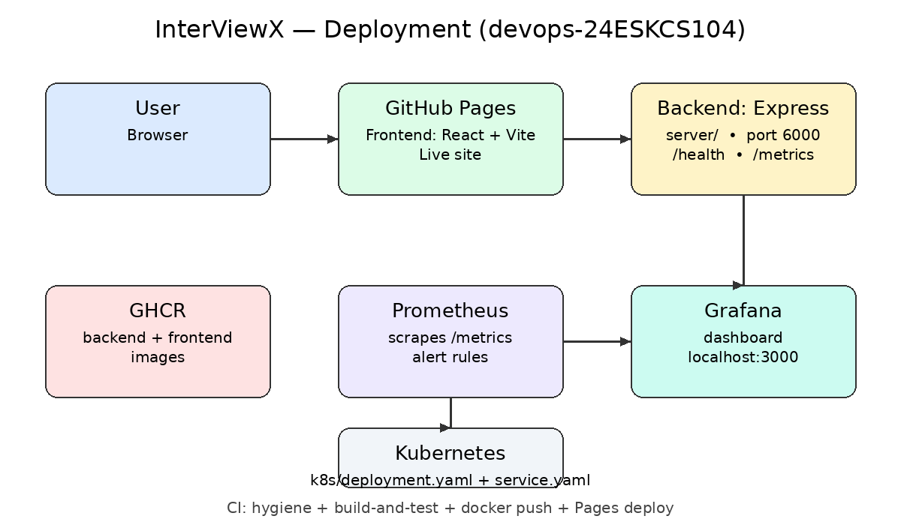

# Deployment — InterViewX (devops-24ESKCS104)

## Live site

🔗 Live: https://skit-devops-2026.github.io/devops-24ESKCS104/

The frontend (React + Vite, in `client/`) is built by the CI
`deploy-pages` job and deployed to GitHub Pages on every push to `main`.
Repository Settings > Pages source must be set to **GitHub Actions**.
Note: as of 2026-10-26, Pages is not yet enabled for this repo — neither
the student accounts with push access have admin access to change that
setting, so an org admin still needs to enable it before the URL above
publishes.

## Run everything locally with Docker

```bash
docker compose up --build
```

| Service | URL |
|---|---|
| Frontend | http://localhost:8080 |
| Backend | http://localhost:6000 |
| Backend health | http://localhost:6000/health |
| Backend metrics | http://localhost:6000/metrics |
| Prometheus | http://localhost:9090 |
| Grafana | http://localhost:3000 (admin / admin) |

## Images

CI pushes images to GitHub Container Registry on every push to `main`:

- `ghcr.io/skit-devops-2026/devops-24eskcs104-backend:latest`
- `ghcr.io/skit-devops-2026/devops-24eskcs104-frontend:latest`

The backend image reports the deployed commit at `GET /health`
(`GIT_COMMIT` build arg, set to the commit SHA by CI).

## Monitoring

Prometheus scrapes the backend's `/metrics` endpoint
(see `monitoring/prometheus.yml` and `monitoring/README.md`).
The Grafana dashboard is `monitoring/grafana-dashboard.json`, and
`monitoring/sample-metrics.txt` contains real metrics captured from a
local backend run. Alert rules live in `monitoring/alert-rules.yml`.

## Kubernetes

```bash
kubectl apply -f k8s/deployment.yaml
kubectl apply -f k8s/service.yaml
```

See `k8s/README.md` for the Deployments and Services.

## Render backend (live)

The backend is deployed on Render (free plan, Docker service
`interviewx-backend-104` from `render.yaml`, built from the root
`Dockerfile` with `/health` as its health-check path):

- 🔗 Live backend: https://interviewx-backend-104.onrender.com
- Health: https://interviewx-backend-104.onrender.com/health — returns `{"status":"ok"}`
- Metrics: https://interviewx-backend-104.onrender.com/metrics

The free plan sleeps when idle, so the first visit after a break can
take ~30 seconds to wake up. The graded frontend deployment above is
GitHub Pages; the Render backend is an additional live deployment.

## Deployment diagram


